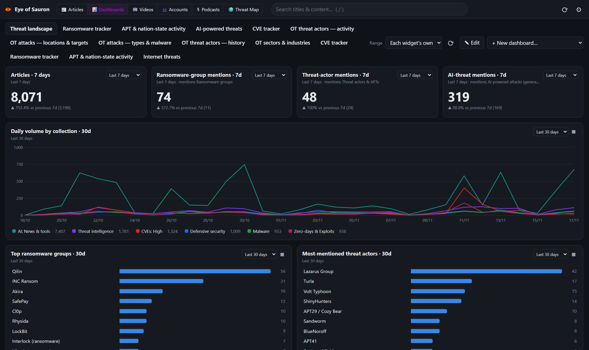
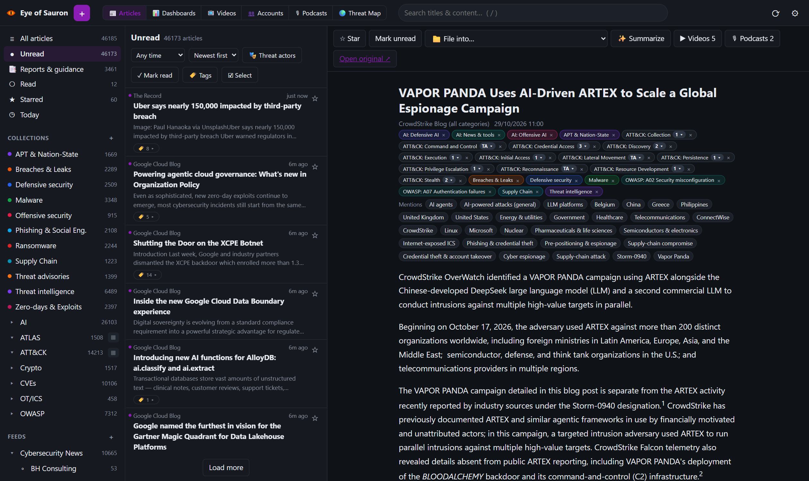
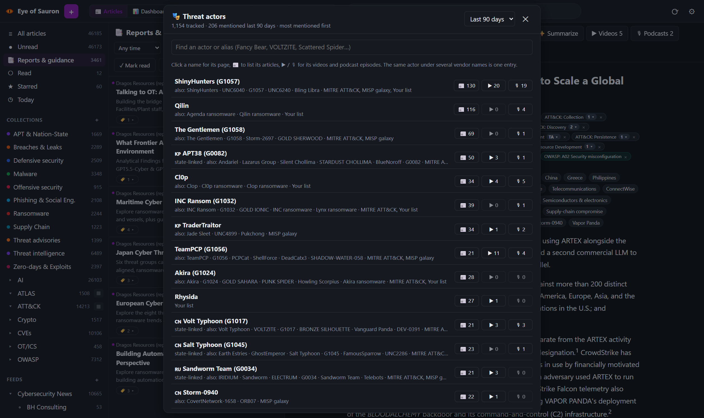
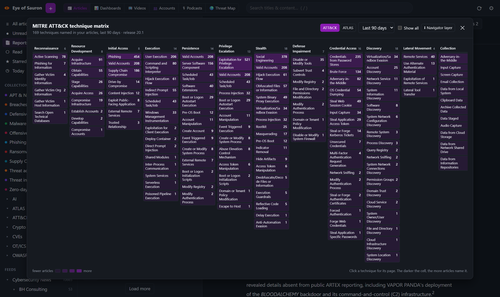
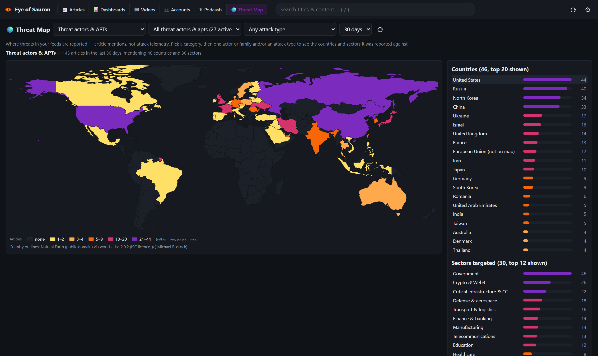
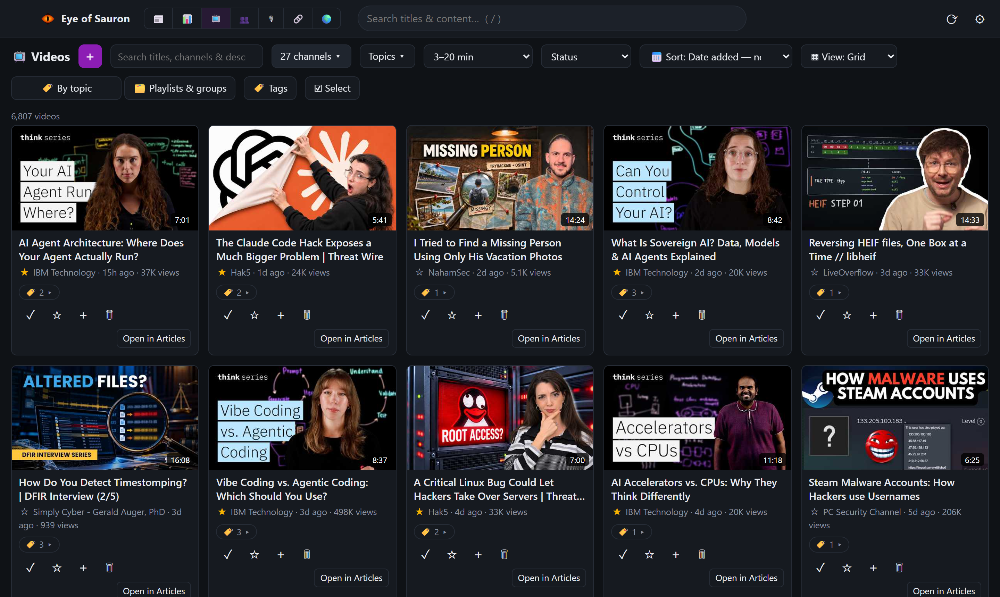
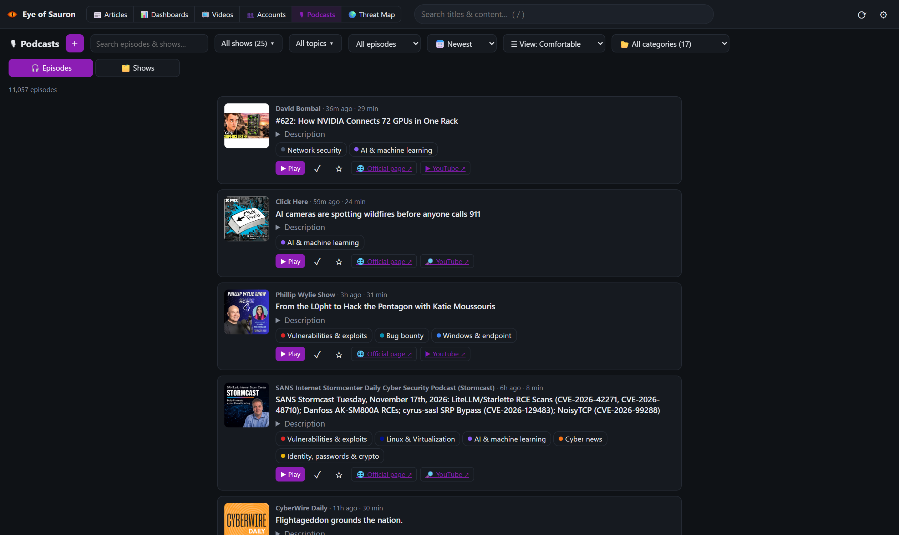

<p align="center">
  
</p>

<h1 align="center"> Eye of Sauron</h1>

<p align="center">
  A self-hosted threat-intelligence reader for security people.<br>
  News, advisories, CVEs, threat actors, MITRE ATT&amp;CK / ATLAS, videos and podcasts — in one place, with no ads.
</p>

<p align="center">
  <a href="#quick-start">Quick start</a> ·
  <a href="docs/users/01_First_steps.md">First steps</a> ·
  <a href="docs/README.md">Documentation</a> ·
  <a href="docs/admins/04_Security_design.md">Security</a> ·
  <a href="CONTRIBUTING.md">Contributing</a>
</p>



## Why

Staying on top of the threat landscape usually means a feed reader, a CVE tracker, a few vendor portals, a YouTube
subscription list, a podcast app and fifty browser tabs. Eye of Sauron puts all of it into one fast, private web app that
you run yourself. It reads public sources only, keeps everything in a single SQLite file, and never phones home.

## Features

**Reading**
- RSS / Atom, websites without feeds (CSS selectors, with a live preview), YouTube channels and playlists, podcasts,
  Mastodon / Bluesky / Reddit accounts, Telegram channels, X through a bridge you run, Hugging Face daily papers.
- Clean three-pane reader with full-text fetching for summary-only feeds and **automatic ad and promotion removal**.
- **Story grouping**: the same story from five sources shows once, with the other sources one click away.
- Folders, collections, keyword rules, starring, search, keyboard shortcuts, dark / light themes, mobile layout.
- **Email newsletters as feeds** (IMAPS, read-only) for publishers that only send updates by email.
- Reader comforts: 🌐 AI title translation per feed, highlight words, reading time and site icons, an **image proxy**
  (publishers don't see your IP), 🔖 read later (Wallabag, Linkwarden, Obsidian, Markdown) and adaptive refresh.
- **🗓️ Keep feeds**: one place to decide how far back article feeds, podcasts, YouTube channels and accounts keep items.
- Works with native RSS apps (Reeder, NetNewsWire, Read You, FocusReader, …) through a Google Reader-compatible API.
- OPML import / export that keeps article feeds, podcasts, YouTube channels and accounts in their own tabs.
- Works on phones and tablets.

**Threat intelligence**
- **📑 Reports & guidance**: advisories, guidance and threat reports from government agencies and CERTs (CISA, ASD's
  ACSC, NCSC UK, CERT-EU, Canadian Cyber Centre, CERT-FR, JPCERT, FBI IC3, …) and vendor research teams (Mandiant,
  Microsoft, CrowdStrike, Unit 42, Talos, Check Point, Recorded Future, SentinelLABS, …) — with instant alerts.
- **🎭 Threat actors**: 1,100+ tracked actors from MITRE ATT&CK, the open MISP galaxy and vendor naming, with every alias
  joined into one actor (APT28 = Fancy Bear = Forest Blizzard). Filter articles, videos and podcasts by actor.
- **MITRE ATT&CK and ATLAS**: tactics, techniques and sub-techniques recognised in every article; collections per tactic
  that follow MITRE's current matrices; a heat-map matrix; ATT&CK Navigator export.
- **CVE tracking** from NVD, CISA KEV and MITRE CWE: severity, exploited-in-the-wild, edge devices, OWASP classes, vendors.
- **Dashboards** (threat landscape, ransomware, APT activity, AI-powered threats, OT/ICS, CVEs) and a **threat map**.
- **Related videos and podcasts** for any article, technique or threat actor.

**Automation**
- Instant alerts and scheduled digests by email, Telegram, ntfy, Discord, Slack or webhook.
- Optional AI briefings and summaries with Claude, OpenAI, Gemini or a **local model** (Ollama, LM Studio, vLLM).
- REST API with scoped tokens, outgoing webhooks, OPML import / export.

**Security**
- Built to be exposed carefully: strict CSP, CSRF protection, rate limits, an SSRF-guarded fetcher, sanitised HTML,
  encrypted credentials, hash-locked dependencies, a non-root read-only container. See
  [Security design](docs/admins/04_Security_design.md).

## Screenshots

| | |
|---|---|
|  |  |
|  |  |
|  |  |

## Quick start

You need Docker with Compose v2.

```bash
git clone https://github.com/s3nt1nel0/eye-of-sauron.git
cd eye-of-sauron
cp .env.example .env          # optional: review the settings
docker compose up -d
```

Open <http://localhost:8080>. On first start the app creates an `admin` account with a random password and writes it
to the data volume:

```bash
docker compose exec eye-of-sauron cat /data/initial_admin_password.txt
```

Sign in, change the password (Settings → Account), then add feeds, or import the starter list
[`examples/cyber-starter.opml`](examples/cyber-starter.opml) (Settings → Feeds → Import OPML).

Exposing it beyond your machine? Put it behind a reverse proxy with TLS first — see
[Installation & deployment](docs/admins/01_Deployment.md).

## Documentation

| | |
|---|---|
| **Users** | [First steps](docs/users/01_First_steps.md) · [User guide](docs/users/02_User_guide.md) |
| **Administrators** | [Installation & deployment](docs/admins/01_Deployment.md) · [Operations](docs/admins/02_Operations.md) · [Configuration](docs/admins/03_Configuration.md) · [Security design](docs/admins/04_Security_design.md) |
| **Developers** | [Architecture & extension guide](docs/developers/01_Architecture.md) · [Development](docs/developers/02_Development.md) |
| **Project** | [Contributing](CONTRIBUTING.md) · [Security policy](SECURITY.md) · [Changelog](CHANGELOG.md) |

## Requirements

- Any Linux host, NAS, Raspberry Pi 4/5, VM or VPS that runs Docker. About 150 MB RAM idle; disk grows with what you keep.
- Or Python 3.12 without Docker ([systemd install](docs/admins/01_Deployment.md#4-linux-without-docker-systemd)).

## License

[GNU Affero General Public License v3.0 or later](LICENSE). Third-party components and data sources are listed in
[THIRD_PARTY_NOTICES.md](THIRD_PARTY_NOTICES.md). Threat-actor names come from MITRE ATT&CK®, the MISP galaxy (CC0 /
BSD-2) and vendors' public naming; MITRE ATT&CK® and ATLAS™ are trademarks of The MITRE Corporation.
